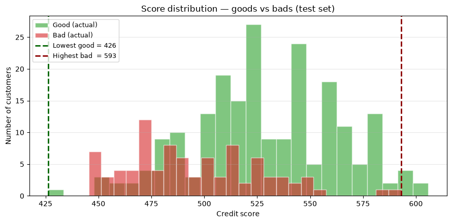
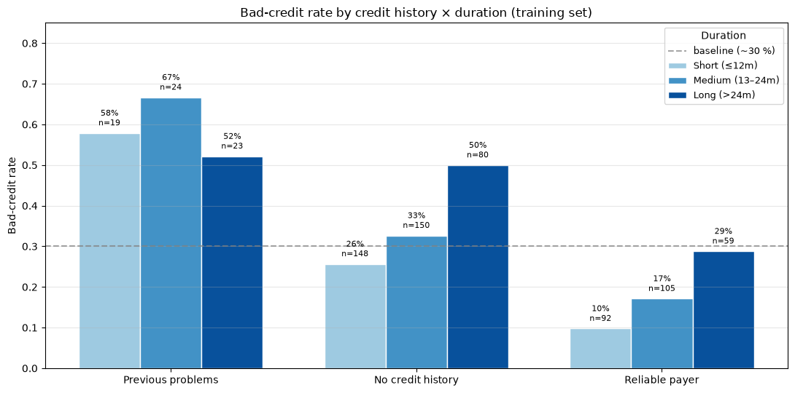
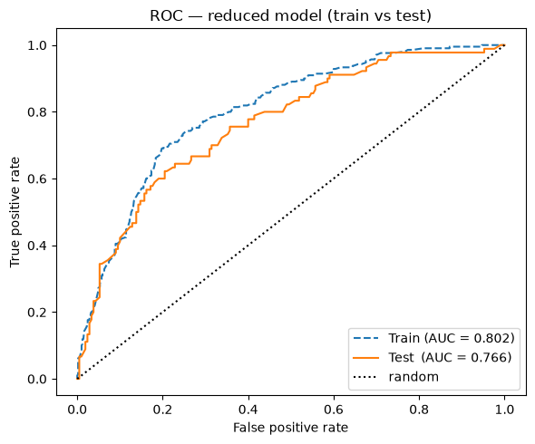

# Credit Risk Scorecard

> A full pipeline that turns the South German Credit dataset into an explainable,
> point-based credit scorecard — with verified equivalence between the model
> and the scorecard.




---

## Overview

This project builds a **credit-risk classifier** for loan applicants and converts
it into a **scorecard** — the format banks actually use in production, where each
applicant characteristic contributes points to a total score.

The work covers four stages:

1. **EDA** — identify the variables that best separate good from bad credits
2. **WOE + IV** — merge levels, transform with Weight of Evidence, select predictors
3. **Logistic regression** — fit on WOE columns, evaluate with ROC/AUC
4. **Scorecard** — convert model coefficients into a point table, verify the
   scorecard reproduces model predictions

---

## Key results

| Metric | Value |
|---|---|
| Final model | Reduced (6 predictors) |
| Train AUC | 0.802 |
| Test AUC | 0.766 |
| Train–test gap | 0.036 (no overfitting) |
| Scorecard reproducibility | 0.000000 difference vs model score |
| Scale verification | 600 ↔ 50:1 odds, PDO = 20 ✓ |

**Top predictors by IV:**
| Variable | IV | Strength |
|---|---|---|
| `status` (checking account) | 0.65 | suspiciously strong — verified as real signal |
| `credit_history` | 0.40 | strong |
| `duration` | 0.24 | medium |
| `savings` | 0.21 | medium |
| `property` | 0.13 | medium |
| `employment_duration` | 0.11 | medium |

---

## 📊 Part 1 — Exploratory data analysis

We compute **spread** (range of bad rate across levels) and **monotonicity** for
all 20 predictors, then pick the two most interesting variables to cross-tabulate.



**Main finding:** the highest *bad-rate* cell (`Previous problems / Medium`, 67 %)
sits in a tiny cell (n=24), while the largest *volume* of bad credits lives in
`No credit history / Medium` (49 bads, n=150). Rate ≠ volume — and volume drives
expected loss for the bank.

---

## 🧮 Part 2 — WOE transformation and logistic regression

Each predictor is binned using a sequential WOE merge (merge cells < 35, merge
zigzags, force monotone WOE, drop IV < 0.02). Levels are then encoded as their
WOE values and fed to a logistic regression.



**Model behaviour:**
- Train AUC = 0.802, Test AUC = 0.766 — small gap, no overfitting
- Coefficient signs all negative (consistent with `WOE = ln(good/bad)` convention)
- Intercept converts to 30 % base rate — matches training base rate

**Why WOE?** It puts every categorical level on a single log-odds scale, so a
logistic regression can treat them uniformly. Coefficients come out interpretable
and comparable across variables.

---

## 🎯 Part 3 — Scorecard

The logistic regression is converted to a **point-based scorecard** using the
standard scale:

```
Score = Offset + Factor · ln(good:bad odds)
Factor = PDO / ln(2) = 20 / 0.6931 = 28.854
Offset = 600 − Factor · ln(50) = 487.12
```

Each level gets `points = base_slice + Factor · β_good · WOE`, where the base
slice is the intercept contribution split evenly across the n predictors.

### Verification

- **Scorecard sum vs model score:** max difference = `0.0000000000` across all
  300 test rows
- **Spec 1:** score 600 ↔ odds 50:1 ✓ (verified on formula and test data)
- **Spec 2:** every +20 points doubles the odds ✓ (ratio = 2.000 on every pair)

### Score distribution


The green bars (goods) sit above the red bars (bads) on average, but the two
distributions overlap in the 470–560 range — that's the AUC 0.766 error zone,
where the model cannot reliably distinguish good from bad.

**The two extreme errors** (dashed lines):
- **Lowest-scoring good (426)** — a repayer rated riskier than all 90 defaulters
- **Highest-scoring bad (593)** — a defaulter rated safer than ~25 % of goods

Both are unavoidable consequences of a moderate classifier. No threshold escapes
both mistakes.

---

## 📂 Repo structure
```
credit-risk-modeling/
|
├── A1_Notebook.ipynb           # Full analysis notebook
├── data/
│   └── South_German_Credit.csv
├── img
├── readme.md
├── README.md
├── REPORT       
│   ├─── A1_Assignment.pdf      # Assignment spec  
│   └── REPORT.pdf              # 3-page report (Part 1–3)
├── requirements.txt
└── venv


```

---

## 🚀 How to run

```bash
# Create environment
python -m venv venv
source venv/bin/activate         # Windows: venv\Scripts\activate

# Install
pip install -r requirements.txt
```

Everything runs on the included `South_German_Credit.csv` — no external API or download step.

---

## 📚 Data source

**South German Credit (2020)**, UCI Machine Learning Repository.
1,000 credit records from a German bank (1973–1975), 20 predictors, binary
target (`credit_risk`). 700 good, 300 bad.

Original documentation: Grömping, U. (2019). *South German Credit Data Set*.

---

## 📝 Report

The full write-up (`A1_Report.pdf`) covers the three parts of the analysis:

1. **Data exploration** — variable choice, grouping, joint group analysis
2. **WOE + logistic regression** — binning strategy, IV ranking, model choice, ROC
3. **Scorecard** — full point table, verification, score distribution

---

## 📄 License

Coursework for *Data Science for Business* (KU Leuven, 2026–2027). Data is
public under CC BY 4.0. Code released under MIT.


